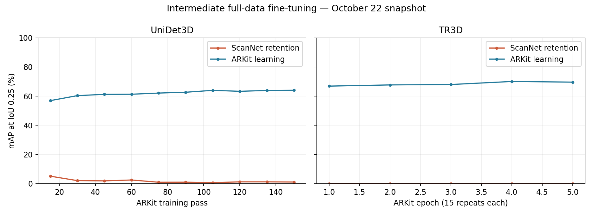

# Week 6 incremental detection progress

Research snapshot through October 22, 2026, 13:55 Singapore time. Week 6 is the project week label. Two full class-incremental runs are complete; six-domain fine-tuning is in progress. The main advance is a measured full-schedule result alongside a broader, auditable cross-dataset training pipeline.

## Completed training results

All scores are mAP percentages. AP25 and AP50 use box IoU thresholds of 0.25 and 0.50. Each row is one run, with two evaluation thresholds.

| Experiment | Seed | Final AP25 | Final AP50 | Interpretation |
| --- | --- | --- | --- | --- |
| TR3D LDMR, SUN40, five stages | 200 | 23.90 | 14.11 | Fresh training with the original SUN schedule |
| UniDet3D LDMR, ScanNet35, five stages | 201 | 38.82 | 24.94 | New host experiment, 180 passes per stage, batch 8 |

TR3D SUN AP25 is 1.20 points below the 25.10 reference value recorded in the original LDMR repository. This is an observed reproduction gap. UniDet3D and TR3D rows use different datasets and cannot be compared as a backbone ranking. Both are single-seed results; variability remains unmeasured.

Earlier released-weight evaluations on SUN gave AP25 of 29.35, 25.03 and 19.38 for three, five and ten stages. Those were evaluator compatibility checks from earlier work, not fresh training completed this week. They are not additional Week 6 results.

[Completed metrics and checkpoint checks](evidence/completed_results.json) contain exact values, all five UniDet3D stage results and saved-state audit fields. [Evidence provenance](evidence/provenance.json) identifies the original local reports by SHA256.

## What changed this week

The full-schedule class experiments now provide two completed results. Earlier short host experiments remain historical and are excluded from the current benchmark because their training exposure differs.

The dataset-incremental pipeline now covers ScanNet → ARKitScenes → S3DIS → MultiScan → 3RScan → ScanNet++. All six prepared datasets passed input audits and annotation export. The setting uses native dataset vocabularies, including ScanNet18, which is different from the ScanNet35 class experiment.

Both detector paths now include fine-tuning, teacher pseudo labels, and LDMR scene replay with learning-dynamics measurements, original Design-2 selection, and online reviewing. Full fine-tuning is running; pseudo labeling and LDMR wait behind it. Implemented paths and component checks do not yet establish final six-domain accuracy.

Stage transitions verify the actual loaded model weights. Frozen source and input identities separate running experiments from later development. Result acceptance requires stage coverage, finite checkpoint and optimizer values, validation coverage, and the correct final evaluation scope.

[Protocol and validation details](PROTOCOL.md) describe the mechanisms, differences and remaining gaps.

## Intermediate forgetting during dataset fine tuning

These are fixed observations from ongoing full-data runs at the snapshot time, not final six-domain scores. The two backbones are at different training progress points.

| Detector and observation | ScanNet AP25 before ARKit | ScanNet AP25 during ARKit | ARKit AP25 | ScanNet AP50 during ARKit | ARKit AP50 |
| --- | --- | --- | --- | --- | --- |
| UniDet3D, ARKit pass 150 of 180 | 60.01 | 1.13 | 64.04 | 0.54 | 49.70 |
| TR3D, ARKit epoch 5 of 12 | 66.14 | 0.01 | 69.61 | 0.00 | 55.44 |

Both learn the incoming domain while losing much of the previous-domain performance. Exact checkpoint transfer checks passed, but this does not rule out every implementation issue. The matched pseudo and LDMR runs are needed to measure whether retention improves. No causal explanation or method ranking follows from these fine-tuning curves alone.

[Full intermediate curves](evidence/intermediate_curves.csv) retain source-log identifiers and source line numbers. TR3D values reflect log rounding.

## Running work and next comparisons

| GPU | Work at the snapshot | Subsequent queue |
| --- | --- | --- |
| 0 | TR3D six-domain fine-tuning, ARKit stage 2 | Full pseudo labeling, then LDMR |
| 1 | UniDet3D six-domain fine-tuning, ARKit stage 2 | Full pseudo labeling, LDMR, ScanNet35 S3/S10 LDMR and joint, then SUN40 S5 fine-tuning/pseudo/LDMR |

No final six-domain row or six-domain average is available. Every domain must be evaluated after the final stage before that row is accepted. Joint training is an upper-bound reference with a different data-access setting.

The next useful milestone is completion of ARKit and continued all-seen-domain evaluation. The October 22 throughput forecast put remaining dataset methods at roughly 6–10 days of baseline-equivalent training, excluding teacher inference, replay and measurement overhead. Later class runs follow that queue; the entire queue will not finish this week. These are planning scenarios, not deadlines.

## Reading order

Start with the completed results, then the intermediate forgetting table and plot. Use [PROTOCOL.md](PROTOCOL.md) for implementation and validation details, and the evidence files for exact values. This folder is a research report and evidence snapshot, not a replacement training distribution. The previous [codebase release](../12_reusable_memory_codebase/README.md) is historical and does not include all Week 6 additions.
